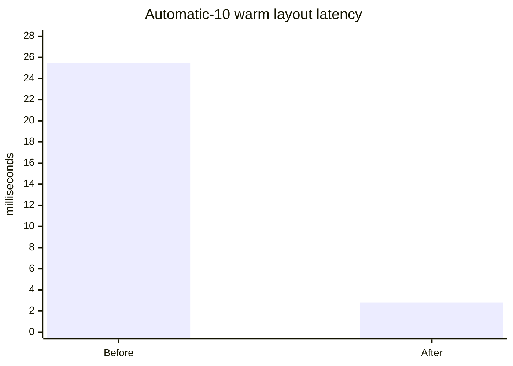

# fmmm-gpu

Standalone CUDA implementation of an FMMM-inspired graph-layout seed engine
with a small Python API. The project accepts a graph and initial coordinates,
runs the GPU layout path, performs GPU-side geometry admission and scoring,
and returns a provenance-carrying publication record.

This repository contains the layout stage only. PTS, PDS, SharedSA, campaign
scheduling, LCN application orchestration, seminar material, and experiment
artifacts remain outside this repository.

## Acknowledgements and provenance

This project is grateful to the authors of the Fast Multipole Multilevel
Method (FMMM/FM3), especially:

> Stefan Hachul and Michael Jünger, “Drawing Large Graphs with a
> Potential-Field-Based Multilevel Algorithm,” Graph Drawing 2004.

- [Paper and publication record](https://doi.org/10.1007/978-3-540-31843-9_29)
- [Open-access paper copy](https://kups.ub.uni-koeln.de/54877/1/zaik2004-472.pdf)
- [OGDF repository](https://github.com/ogdf/ogdf)
- [OGDF FMMMLayout documentation](https://ogdf.github.io/doc/ogdf/classogdf_1_1_f_m_m_m_layout.html)

The paper provides the mathematical and algorithmic foundation for the
multilevel force-directed method and its potential-field/multipole ideas. The
OGDF implementation is used as a reference for algorithm structure, options,
and comparison behavior. The CUDA implementation in this repository is our
own GPU-oriented reimplementation and adaptation; it is not a claim of
binary-identical OGDF behavior and does not redistribute the OGDF source tree.

The comparison work uses the pinned OGDF reference profile
`ogdf-foxglove-202510` at commit
`5b6795655399b9d8e2921afec9d97bab9107d5ee`. OGDF is an optional comparison
reference, not a runtime dependency of the Python CUDA extension.

## Data and execution flow

```text
Python graph input
        |
        v
Input normalization and boundary checks
        |
        v
Host -> GPU graph upload
        |
        v
GPU FMMM-inspired layout path
  hierarchy / coarsening
  placement / force evaluation
  Barnes-Hut or NMM-style device work
  uncoarsening / coordinate publication
        |
        v
GPU geometry admission and FULL_SQUARE_GPU recount
        |
        v
Python publication record
  status / coordinates / score / timing / provenance
```

The GPU admission and recount are part of the trust boundary. A layout is not
reported as accepted merely because the force loop produced coordinates. The
returned score contains the lexicographic objective `(K, nK, Phi, C)` together
with edge-crossing counts and validity fields.

## Python API

The Python API provides high-level functions with typed dataclasses, complete dictionary backward-compatibility, and ecosystem adapters for NetworkX, NumPy, and PyTorch:

```python
from fmmm_gpu import seed_layout, layout_networkx

# 1. Direct low-level invocation
record = seed_layout(
    node_count=4,
    edges=[(0, 1), (1, 2), (2, 3), (3, 0)], # supports 2-tuples or 3-tuples (u, v, layer)
    width=800.0,
    height=600.0,
    iterations=50,
    seed=42,
)

# Object-oriented typed attributes:
print(f"Status:     {record.status}")
print(f"Dimensions: {record.width} x {record.height}")
print(f"Crossings:  {record.score.K}")
print(f"Energy:     {record.score.E}")
print(f"Total time: {record.timings.total_ms:.2f} ms")

# Or legacy dict-style access (100% backward compatible):
print(record["coordinates"])
print(record["status"])

# Export directly to NumPy or PyTorch:
coords_np = record.to_numpy() # shape (N, 2), dtype float64
coords_pt = record.to_torch() # torch.Tensor shape (N, 2)

# 2. High-level NetworkX integration
import networkx as nx

G = nx.karate_club_graph()
# Direct position dictionary ready for nx.draw:
pos = layout_networkx(G, width=1000.0, height=1000.0, return_dict=True)
nx.draw(G, pos=pos, with_labels=True)
```

The native pybind11 module exports both `_fmmm_cuda` and `planar_cuda_refactored` symbols, allowing modern packaging while preserving exact backward ABI compatibility with legacy callers.

## Key Architectural & GPU Optimizations

1. **CUDA Graph Capture & Replay**: Eliminates host-dispatch latency during repetitive force iterations by capturing the multipole and spring relaxation kernel sequences into an executable CUDA Graph (`cudaGraph_t` / `cudaGraphExec_t`).
2. **Tiled Shared-Memory Coordinate Caching**: In exact force computation (`exact_force_loop_small_kernel`), node coordinates are staged into 256-thread `__shared__` tiles (`sh_x`, `sh_y`), slashing redundant global memory traffic and saturating compute units.
3. **Dynamic Convergence & Early Stopping**: Tracks maximum displacement $\Delta_{\max}$ across relaxation iterations; when $\Delta_{\max} < 0.001 \cdot d_{\text{ideal}}$, execution terminates early on-device without wasting GPU cycles on infinitesimal adjustments.
4. **AABB Spatial Pruning for Edge Crossings**: Evaluates bounding boxes $[x_{\min}, x_{\max}] \times [y_{\min}, y_{\max}]$ for candidate edge pairs in `continuous_cross_device_kernel`, fast-rejecting disjoint segment pairs before running costly 2D orientation and determinant math.
5. **Architectural Pruning & Decoupling**: Excised legacy PTS/PDS/SharedSA simulated annealing and proposal logic from `resident_api.cu`, leaving a lean, dedicated FMMM layout engine.

## Requirements

- **Operating System**: Linux (Ubuntu 20.04+, RHEL 8+, WSL2) or Windows 10/11
- **Compilers**: GCC 9+ / Clang 11+ (Linux) or MSVC 2022 (Windows)
- **CUDA Toolkit**: CUDA 11.8, 12.x, or 13.x with `nvcc`
- **GPU Architectures**: NVIDIA Volta (`sm_70`), Turing (`sm_75`), Ampere (`sm_80`, `sm_86`), Ada Lovelace (`sm_89`), or Hopper (`sm_90`)
- **Python**: 3.9 through 3.13
- **Python Dependencies**: `pybind11>=3.0` (core build); `networkx`, `numpy`, `pytest` (optional ecosystem & testing)

## Build Instructions

### Linux / WSL (Direct Bash Script)

```bash
# Install Python dependencies
pip install -r requirements.txt

# Build with nvcc for your target GPU architecture (default: sm_89)
./build.sh --arch 89

# Or specify custom paths if needed:
./build.sh --arch 80 --python /usr/bin/python3 --cuda /usr/local/cuda
```

### Windows (PowerShell Script)

From a Developer PowerShell:

```powershell
python -m venv .venv
.\.venv\Scripts\python -m pip install -r requirements.txt
.\build.ps1 -Python .\.venv\Scripts\python.exe -Architecture 89
```

### Cross-Platform CMake Build

```bash
# Configure and build across Linux or Windows
cmake -S . -B build -DCMAKE_BUILD_TYPE=Release -DFMMM_CUDA_ARCHITECTURES="75;80;86;89;90"
cmake --build build --config Release -j
```

## Running the Standalone Test Suite

The repository includes a comprehensive `pytest` test suite covering data structures, input validation, geometric invariants, NetworkX integration, and topology stress testing.

When running on systems without an active NVIDIA GPU (such as CPU CI workers), tests automatically fall back to an internal synthetic mock engine, verifying all Python contracts, data conversions, and invariants seamlessly:

```bash
pip install -r requirements-dev.txt
pytest -v
```

## Result contract

An accepted result is expected to contain:

- `status == "OK"`
- `coordinates`
- `score.valid` and `score.exact_valid`
- `score.K`, `score.nK`, `score.Phi`, and `score.C`
- `score.edge_crossings`
- admission/provenance fields supplied by the native publication path

Invalid inputs and rejected layouts are represented as structured records;
callers should not silently repair a rejected layout and then label it as an
FMMM result.

## Timing semantics

Timing fields must be interpreted with their seam. `layout_ms` is intended to
measure the layout schedule that produces coordinates. GPU admission,
geometry validation, exhaustive recount, and bounded result transfer are
reported as separate work when the surrounding experiment protocol records
them. Including scoring inside a layout timer answers a different question.

The performance tables at the end of this README are a labelled research
snapshot from the accompanying paper/report. They are not a promise that every
fresh checkout reproduces the same numbers. Any new benchmark must freeze the
graph corpus, seed, FMMM profile, CUDA architecture, compiler, warm-up policy,
and timing boundaries, and must publish the corresponding raw manifests.

## Current qualification boundary

The current implementation is a GPU FMMM-inspired seed path with GPU-side
admission and recount for its declared test envelope. It is not yet a
formula-by-formula, coordinate-identical OGDF port. Known differences include
force arithmetic, precision, reduction/order choices, and selected hierarchy
behavior. Comparisons should therefore report validity and GPU-scored
objective values under a frozen protocol rather than claiming exact OGDF
coordinate parity.

The native translation units have been fully decoupled and cleaned: all legacy
PTS/PDS/SharedSA simulated annealing and proposal logic has been excised from
`resident_api.cu`. The C++ binding now exports both `_fmmm_cuda` and
`planar_cuda_refactored` for drop-in ABI compatibility.

## Repository layout

```text
src/cuda_utils/oracle/       GPU graph storage, AABB continuous crossings, FULL_SQUARE_GPU authority
src/cuda_utils/release/      FMMM hierarchy, CUDA Graph replay, tiled force loops, NMM, session
python/fmmm_gpu/             public Python facade (dataclasses, NetworkX/NumPy/PyTorch interop)
tests/                       standalone pytest suite (fixtures, invariants, corpus, mock backend)
build.ps1                    direct Windows/NVCC build script
build.sh                     direct Linux/WSL/NVCC build script
CMakeLists.txt               cross-platform multi-arch CMake configuration
pyproject.toml               modern packaging manifest and optional dependencies
requirements.txt             core build dependency
requirements-dev.txt         testing and interop dependencies
EXTRACTION_MANIFEST.md       provenance notes and release blocker audit
```

## Performance evidence from the paper/report

The following tables come from the FMMM sections of the GPU engineering paper
and its measurement reports. They are included to make the performance story
visible to users of this standalone repository. The measurements are labelled
`REFERENCE_ONLY` / `ORIENTATION`, not as a protocol-identical reproduction of
the original paper or as a guarantee for all hardware.

### Hardware and timing protocol

- NVIDIA GeForce RTX 4060 Laptop GPU, 8,188 MiB, driver 581.57
- Native Windows measurement environment for the post-fusion sweep
- Python 3.11, CUDA 13.0, MSVC 2022, Ada `sm_89`
- Five warm repetitions after one labelled warm-up for the selected tables
- FMMM layout timing excludes post-timing geometry admission and exhaustive
  scoring; those gates are checked after the timed layout region
- `layout_ms` is layout latency; `device_ms` is the device-side layout event
- Batch throughput is layouts/second and must not be substituted for
  single-layout latency

### A10 NMM launch fusion

| Metric | Before | After |
| --- | ---: | ---: |
| NMM-related kernel instances/call | ~2,125 | ~205 |
| `cudaLaunchKernel`/call | ~2,270 | ~349 |
| Warm layout latency (ms) | 25.437 | 2.802 |
| Warm device time (ms) | 21.733 | 2.453 |

This is the main optimization story: the FMMM path was launch-bound, so
reducing launch/control-plane overhead mattered more than only tuning one force
kernel.



### Single-layout OGDF CPU FMMM / CUDA comparison

The CPU column is the FMMM CPU reference produced by the OGDF repository's
`ogdf::FMMMLayout` implementation. The CUDA column is our GPU-oriented
reimplementation measured against that OGDF FMMM reference under the stated
experiment protocol. This is a comparison of layout latency and reported
speedup; it is not a claim that the CUDA path is the original OGDF binary or
that coordinates are identical.

| Instance | Nodes/edges | CPU (ms) | CUDA warm (ms) | Reported speedup |
| --- | ---: | ---: | ---: | ---: |
| Automatic-1 | 24/27 | 37.132 | 15.175 | 2.45× |
| Automatic-10 | 180/716 | 59.940 | 6.678 | 8.98× |
| Automatic-13 | 1,936/3,531 | 453.855 | 84.141 | 5.39× |

These are selected official inputs from the paper/report protocol. The numbers
must be read with the stated environment and timing seam; they are not a
claim of universal CUDA speedup.

### Post-fusion Automatic-1..15 layout latency

| Instance | Nodes | Edges | `layout_ms` | `device_ms` |
| --- | ---: | ---: | ---: | ---: |
| Automatic-1 | 24 | 27 | 0.647 | 0.384 |
| Automatic-2 | 56 | 102 | 0.515 | 0.340 |
| Automatic-3 | 15 | 50 | 0.386 | 0.274 |
| Automatic-4 | 16 | 71 | 0.483 | 0.306 |
| Automatic-5 | 21 | 71 | 0.574 | 0.331 |
| Automatic-6 | 68 | 138 | 0.597 | 0.413 |
| Automatic-7 | 156 | 219 | 0.963 | 0.732 |
| Automatic-8 | 75 | 153 | 0.640 | 0.474 |
| Automatic-9 | 1,024 | 1,984 | 7.042 | 6.223 |
| Automatic-10 | 180 | 716 | 2.667 | 2.435 |
| Automatic-11 | 967 | 1,872 | 6.975 | 5.666 |
| Automatic-12 | 246 | 1,201 | 3.199 | 2.808 |
| Automatic-13 | 1,936 | 3,531 | 11.779 | 10.765 |
| Automatic-14 | 300 | 5,250 | 5.785 | 5.322 |
| Automatic-15 | 4,704 | 9,200 | 37.398 | 35.435 |

The table shows the measured scaling trend for this corpus: larger graphs and
deeper multipole work generally require more layout time, but these points do
not establish a closed-form complexity model.

### Automatic-10 multi-layout throughput

| Batch size `B` | CPU layouts/s | CUDA layouts/s | Batch speedup |
| ---: | ---: | ---: | ---: |
| 2 | 6.93 | 58.43 | 8.44× |
| 4 | 6.37 | 99.07 | 15.56× |
| 8 | 6.96 | 255.48 | 36.68× |

Batch speedup reflects amortization and device-side batching. It is a
throughput experiment, not a single-layout latency result. The report defines
the CPU baseline as sequential OGDF calls and the CUDA side as one batched
invocation under that experiment's implementation and measurement boundary.

### Source reports

- `v0_fmmm_timing_seam.md`: timing boundary and A1/A10/A13 comparison
- `v0_fmmm_paper_table12_remasure.md`: paper Table 1/2 orientation report
- `v0_fmmm_nmm_launch_fuse_merge.md`: NMM launch-fusion measurement
- `v0_fmmm_a1_a15_after_nmm_fuse.md`: A1–A15 post-fusion sweep

The standalone repository intentionally publishes the summary tables rather
than copying the entire parent project's experiment archive. The raw source
reports and manifests remain in the research repository and should be used for
full reproduction or audit.

## License

Copyright 2026 Ming-Han Tsai.

This project is licensed under the [Apache License 2.0](LICENSE). OGDF and
the FMMM paper are acknowledged references; their own licenses and terms
remain separate and must be reviewed before redistributing any third-party
material.
